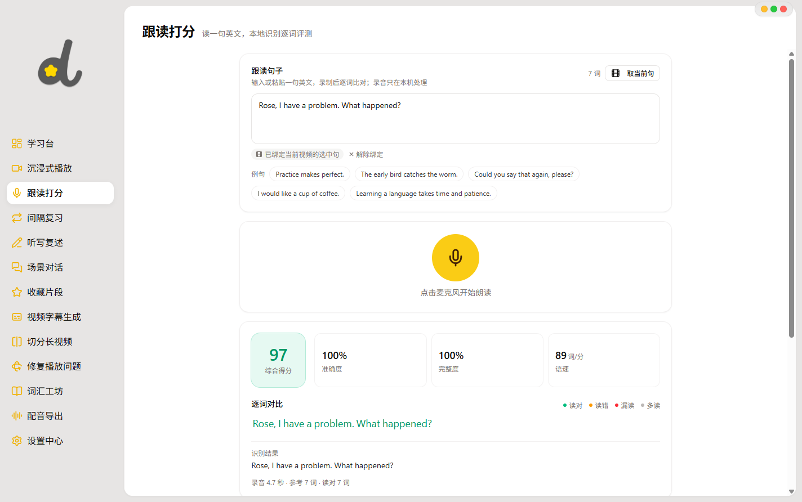
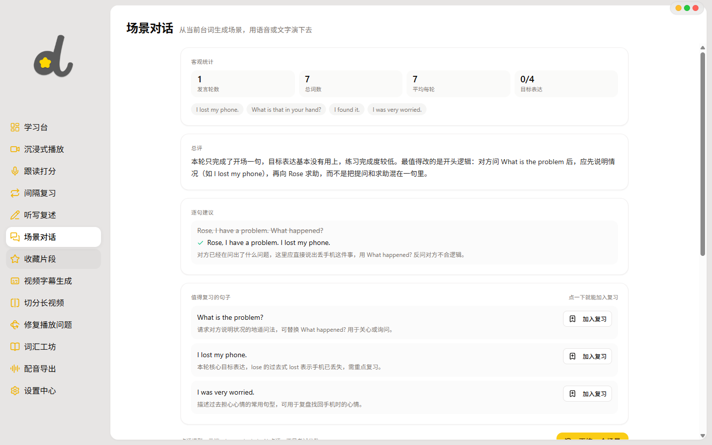
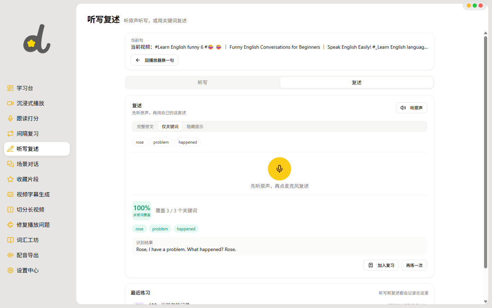
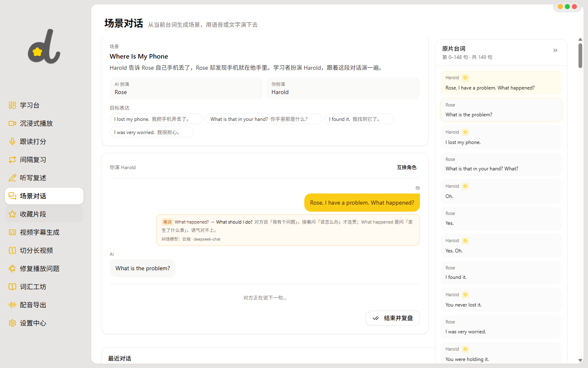
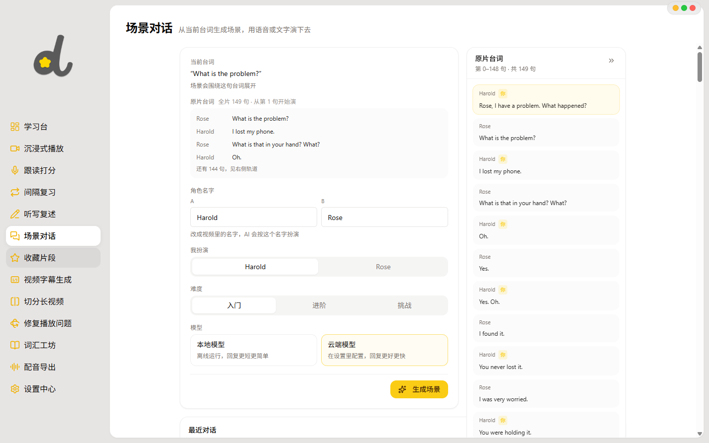

# DashPlayer · English Learning Edition

> An English-learning fork of [DashPlayer](https://github.com/solidSpoon/DashPlayer), built around one unit: **the video sentence**.
> This is a community modification, **not** an official DashPlayer release.

[](LICENSE)


<p align="center">
  
  
</p>

## Why

Most video-based English learning stops at listening. Learners understand a line but never speak it, get specific feedback, review it, or reuse it.

This fork turns DashPlayer into a loop around the sentence you just heard:

```text
Watch → hear a line → shadow → word-level feedback → save
      → spaced review (shadow again)
      → dictation / retell → feedback
      → scene dialogue → review notes → good lines saved
```

Every item points back to `videoKey + sentenceIndex`, so the original context is never lost.

### One engine, five views

These pages are not five products; they are five tasks on one engine:

```text
sentence (videoKey + sentenceIndex)
  → play audio → record → local ASR → word alignment → score
  → store attempt → (optionally) schedule a review card
```

What changes per page is the **task** and therefore the **scoring rule**:

| Page | Task | How it is judged |
|---|---|---|
| Shadowing | say the line after hearing it | word-by-word against the line |
| Spaced review | say it again when due | same word-by-word score; pass moves the card forward |
| Dictation | type what you hear | word-by-word against the line |
| Retell | say it in your own words | keyword coverage, not exact wording |
| Scene dialogue | say your part in a scripted conversation | per-line correction (wording / grammar / pronunciation), script followed line by line |

If two of these feel identical to you, that is useful feedback: it means the task does not differ enough to justify its own page. That is the next thing being fixed.

## What this fork adds

| Area | What it does |
|---|---|
| **Shadowing** | Record a line; local ASR + word alignment mark correct / wrong / missing / extra words. Honest word-level scoring — no fake pronunciation score. |
| **Spaced Review** | Review means listening and shadowing again. The backend reads the real attempt score; a pass postpones the card (1/3/7/14/30 days), a fail returns it immediately. |
| **Dashboard** | Today’s practice (shadowing + dictation/retell + dialogue turns), streak, 7-day activity. |
| **Dictation & Retell** | Word-by-word dictation check; retelling scored by keyword coverage, not exact wording. |
| **Scene Dialogue** | Rehearses the clip's own dialogue. The whole subtitle track becomes a script rail; the AI speaks the next original line (it does not invent lines), the learner says their part, each line is spoken before the next appears, and every learner line gets a per-line correction card. Review at the end; good lines go into the same queue. |
| **Local-first models** | Dialogue can run on the bundled Qwen3.5 2B (offline) or any OpenAI-compatible endpoint (cloud or local Ollama). The UI always shows which model produced the feedback. |

### Three evaluation layers (and what is deliberately missing)

1. **Computed stats** — turns, words, targets used. Objective and reproducible.
2. **Labeled AI feedback** — grammar, word choice, rewrites; labeled “AI feedback, not an exam score”.
3. **Word-level speaking score** — only when a reference text exists (shadowing / “shadow this line”).

There is **no phoneme, stress, or intonation score** for free speech. The local recognizers output words, not phoneme alignments; producing such scores would be fake.

## Screenshots

| | |
|---|---|
|  |  |
| Word-level shadowing feedback | Spaced review driven by a real score |
|  |  |
| Dictation check | Retelling by keyword coverage |
|  |  |
| Rehearsing the clip line by line | Per-line correction under the learner's line |
|  |  |
| Review: stats, line feedback, good lines | Setup: script rail, roles, difficulty |
|  |  |
| Dashboard | The player and the current line |

## Architecture

```text
Renderer (React features)
  → featureApi → backendClient → window.electron.call
  → Main Controller → Service → Infrastructure (DB / ffmpeg / ASR / filesystem)
```

- Front end: `src/fronted/features/<domain>/`
- Back end: `controllers / services / infrastructure / ioc`
- Contracts: `src/common/contracts/**`, `src/common/api/api-def.ts`
- SQLite + Drizzle; migrations `0007`–`0012` add the learning tables.
- Shared engines: tokenization, word alignment, sentence audio, recorded speech, recorder hook, local-model adapter.

## Quick start

Requirements: Node 20+, Yarn 1.x (via Corepack), Windows/macOS/Linux (tested on Windows 11).

```bash
corepack yarn install
corepack yarn start        # development
corepack yarn package      # build in out/
```

On Windows, if Electron download is slow:

```powershell
$env:ELECTRON_MIRROR = "https://npmmirror.com/mirrors/electron/"
corepack yarn package
```

Local speech recognition / TTS runtimes and models are downloaded by `scripts/download.mjs` or configured in **Settings → Services & Resources**. The bundled local LLM (Qwen3.5 2B) is an optional download in the same settings area.

Quality gates used during development:

```bash
corepack yarn lint
corepack yarn tsc --noEmit
corepack yarn package
```

## Data and privacy

- Shadowing, dictation, and retelling audio is processed **locally**.
- When “cloud model” is selected, scene/dialogue/review text is sent to the endpoint **you** configure.
- The database lives in `%APPDATA%\DashPlayer\data\dp_db.sqlite3`; API keys live in `config.json`. Neither is committed.

## Project status

- Baseline tag: `portfolio-p6`.
- All five learning stages are implemented and tested end-to-end on Windows.
- The local 2B model can run offline but gives weaker scene relevance and feedback than cloud models; the UI labels the reviewing model.
- Not tested on macOS/Linux in this fork; the upstream project supports them.

## License and attribution

- Based on **DashPlayer 6.19.1** by solidSpoon — https://github.com/solidSpoon/DashPlayer — **AGPL-3.0**.
- This fork remains under **AGPL-3.0**; see [LICENSE](LICENSE) and [NOTICE](NOTICE).
- If you distribute a built application, you must also make the corresponding source available under AGPL-3.0.
- Video clips used in demos/screenshots are **not** distributed with this repository; copyright remains with their owners.
- This is an independent modification, not endorsed by the upstream author.

---

## 中文简介

这是 [DashPlayer](https://github.com/solidSpoon/DashPlayer) 的英语学习修改版，以“视频句”为唯一学习单元，串起跟读打分、间隔复习、听写复述、场景对话与学习台。

- 五个页面共用一套引擎（取句 → 播/录 → 本地识别 → 逐词对齐 → 打分 → 进复习队列），区别在任务与判定规则；任务形态不够区分的地方，会合并而不是再开一个页面。
- 场景对话照原片台词逐句演：AI 念剧本原句而不是自由发挥，一句读完才出下一句，每句下方给纠错卡。
- 评分只做词级，不做假音素级；对话点评标注模型来源，不冒充考试分数。
- 对话模型可切换内置本地模型（离线）或 OpenAI 兼容接口。
- 代码基于 AGPL-3.0 开源；影视素材仅本地演示，不随仓库分发。

构建与验证命令见上文 Quick start；数据表与迁移见 `drizzle/`。
